# Random Assignment of Ad Treatment

## Randomizer Setup

{width="500"}

## Branch Logic and Complete Survey Flow

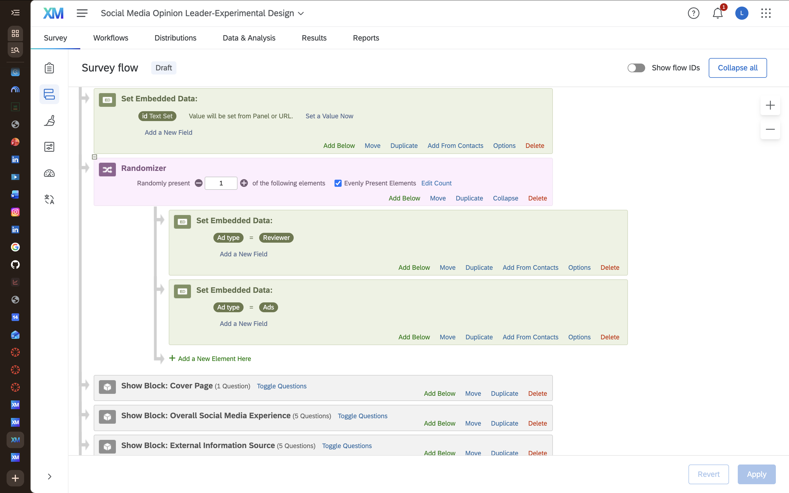{width="500"}

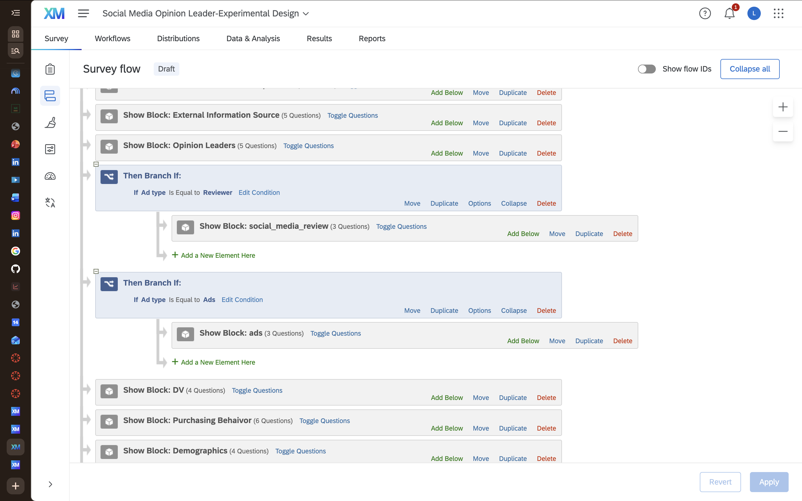{width="500"}

## Testing the Random Assignment

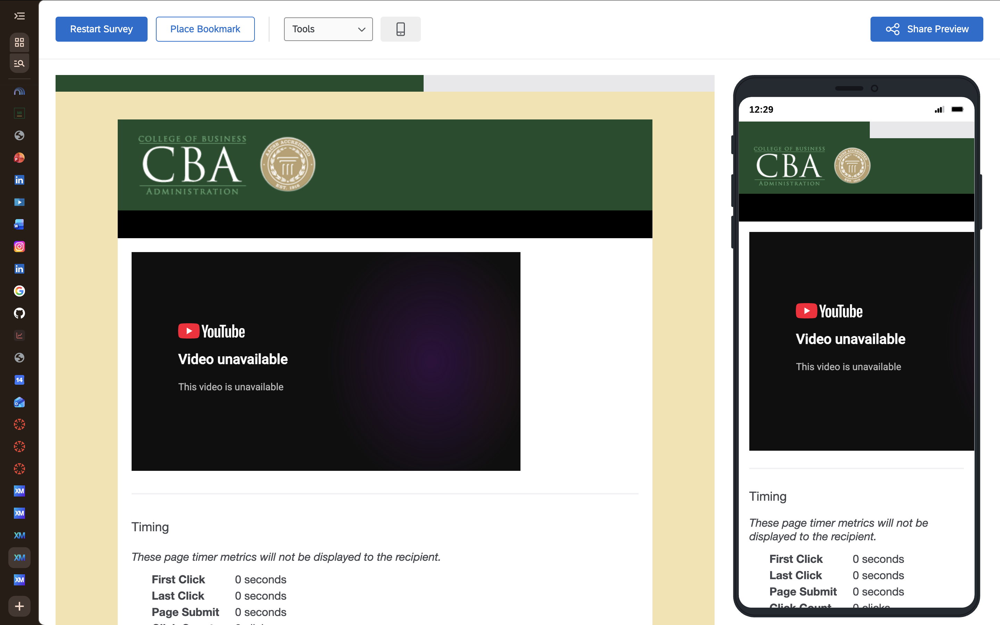{width="500"}

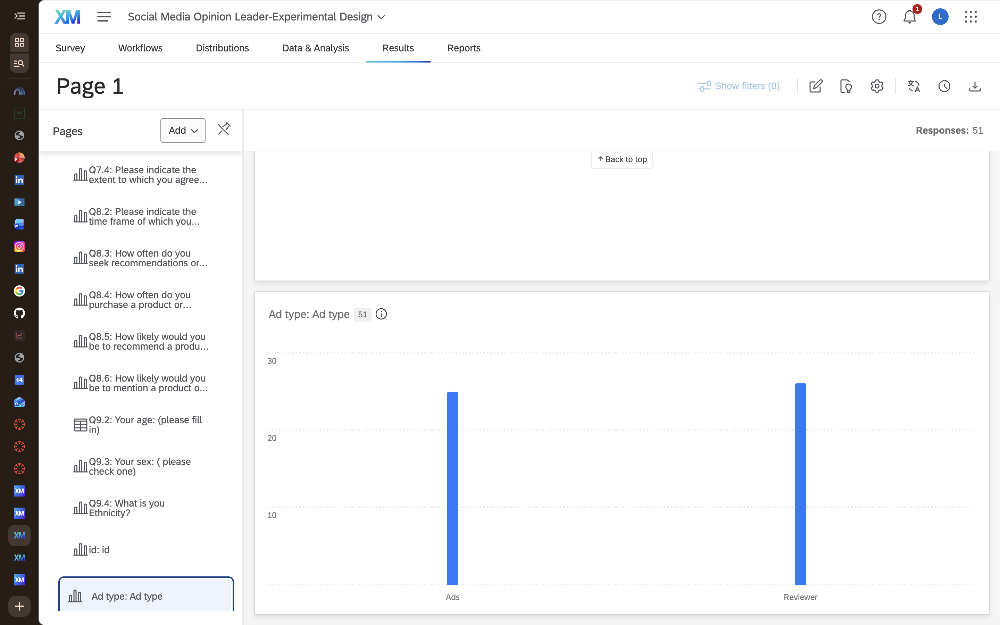{width="500"}

# Redesigning Q2.2: Usage by Platform

## Problem with the Original Question

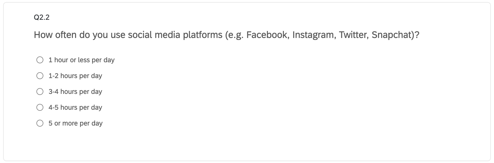

## Step 1: Multi-Select Platform Question

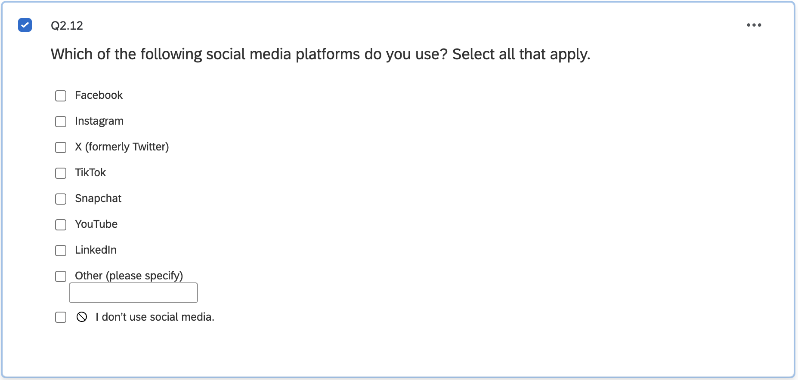{width="500"}

## Step 2: Carry Forward Usage Matrix

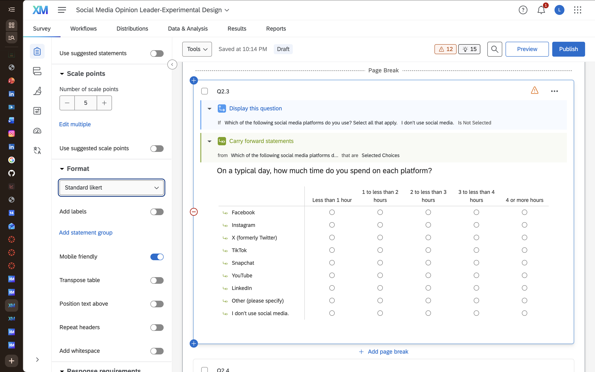{width="500"}

## Preview Test

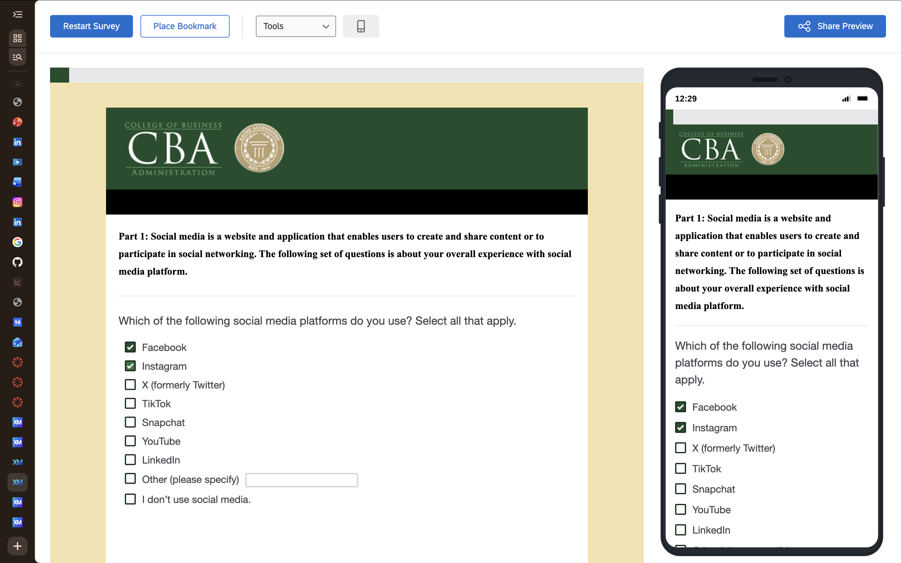{width="500"}

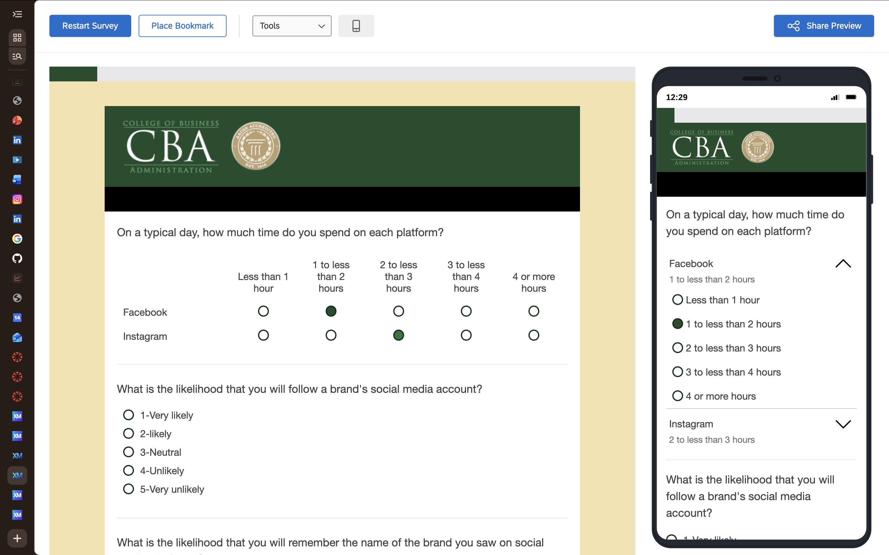{width="500"}

# Additional Questionnaire Improvements

## Improvement 1: Non-Overlapping Time Ranges

Time ranges in Q2.3 no longer overlap, but are more specific, such as 1 to less than 2 hours.

## Improvement 2: Fixed demographic questions

Fixes to demographic section are more politically correct and inclusive. Other now features a text box and the option to not share if the respondent is uncomfortable self-identifying.

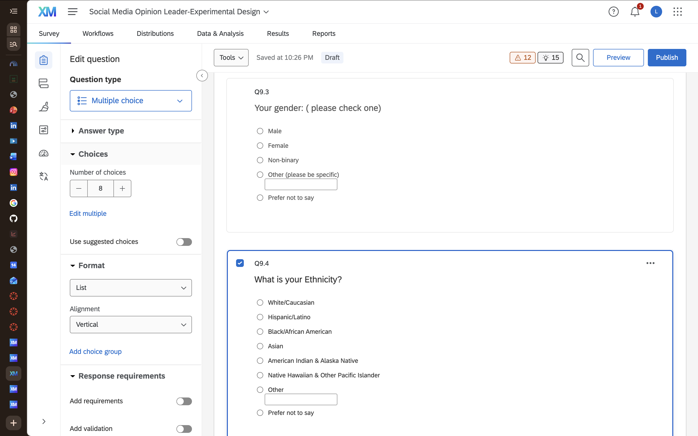{width="500"}

## Improvement 3: Progress bar

A progress bar shows respondents how much of the survey remains, which sets clear expectations and reduces the chance they drop out partway through.

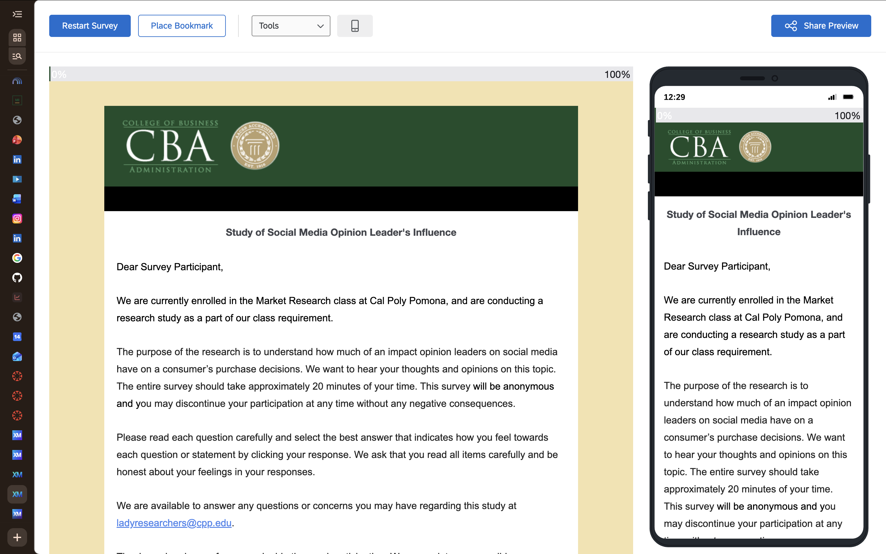{width="500"}

# Appendix

- GitHub Repo

- GitHub Pages
